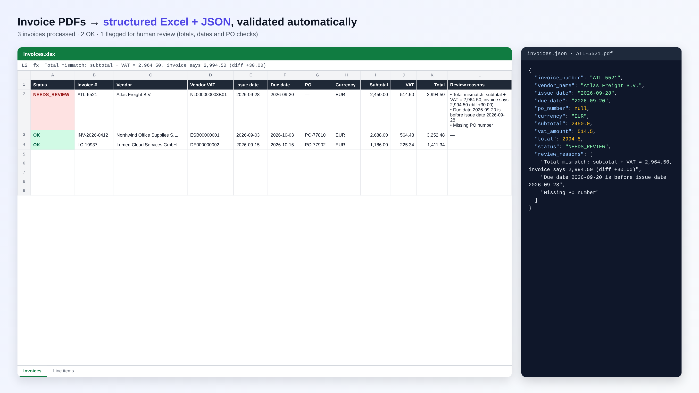
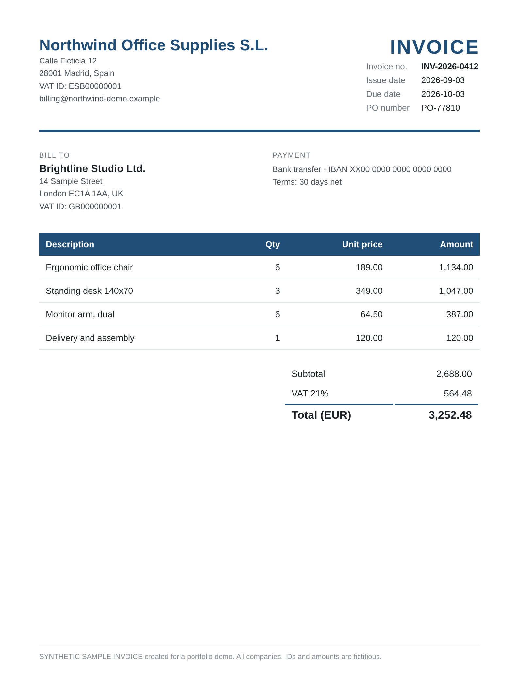
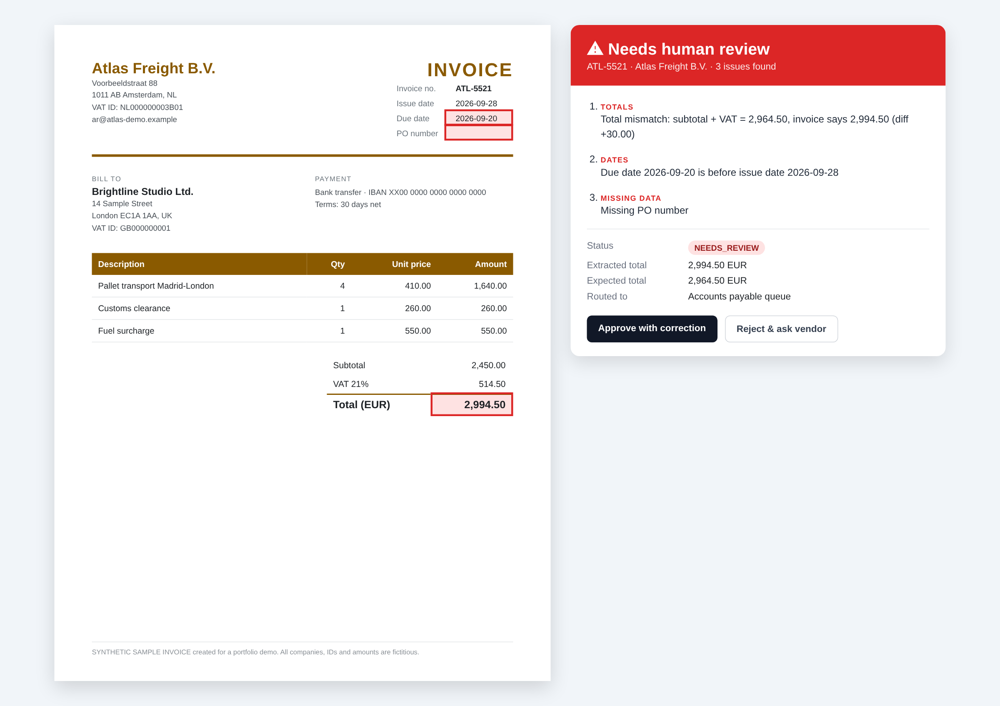

# Invoice extraction and validation

Turns invoice PDFs into structured **JSON and Excel**, checks the numbers, and
flags the invoices a person should look at before they are paid.



## What it does

1. **Extracts** the header fields (invoice number, vendor, VAT IDs, dates, PO
   number, currency) and every line item from each PDF.
2. **Validates** each invoice against rules an accounts-payable team cares about:
   - line items add up to the subtotal
   - VAT is the stated rate applied to the subtotal
   - subtotal plus VAT equals the total
   - the due date is not before the issue date
   - a purchase-order number is present
3. **Routes** anything that fails a rule to `NEEDS_REVIEW`, with the reasons in
   plain language, and exports everything to `output/invoices.json` and
   `output/invoices.xlsx` (sheets: *Invoices* and *Line items*).

| Input invoice | Flagged for review |
|---|---|
|  |  |

On the three sample invoices, two pass and one is flagged for three reasons: the
total is 30.00 higher than subtotal plus VAT, it falls due before it was issued,
and it has no PO number.

## Run it

```bash
pip install -r requirements.txt
python extract.py invoices/*.pdf          # writes output/invoices.json and output/invoices.xlsx
```

## The sample invoices are synthetic

Every company, VAT ID, IBAN and amount in `invoices/` is invented for this demo.
`synthetic/` holds the generator: `data.py` defines the invoices (including the
deliberate errors in ATL-5521), `render.py` writes them as HTML, and
`render_pdf.js` prints them to PDF with Playwright.

## In a client project

These PDFs share one clean layout, so the extraction step here is text parsing
with `pdfplumber`. Real supplier invoices vary in layout and are often scanned;
there the extraction step becomes OCR plus an LLM that returns the same JSON
schema. The validation and review routing stay exactly as they are, and they are
the part that keeps a wrong total from being paid.

---

Cristina Crespo Barreda · AI/ML engineer
